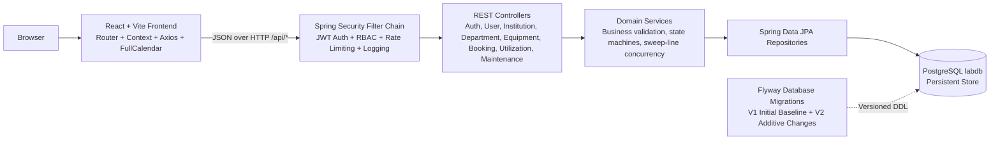

# Milestone 1 Architecture and Workflows

**Evidence date:** 2026-10-26. This document describes source configuration, architecture, and implemented workflows for Milestone 1.

## Scope and requirement sources

The original mentor PDF (`JAVA_Intelligent Laboratory Equipment Sharing and Resource Utilization Optimization Platform.pdf`) and Excel tracker (`Task Tracker Lab_Resource_Utilization_Platform.xlsx`) at the project root serve as authoritative sources. Both `Team A` and `Team B` sheets place tasks T1–T17 in Milestone 1. The mentor PDF defines the M1 evaluation criteria and Week 1–2 scope.

## Architecture

The platform follows a modular monolith architecture with a React frontend communicating over HTTP/JSON with a Spring Boot backend:

### Architectural layers and boundaries:
- **Presentation Layer:** React 19 + Vite frontend with Tailwind CSS styling, React Router v7 navigation, React Context auth state, and FullCalendar integration.
- **Security & Gateway Boundary:** Embedded in the Spring Boot application via `SecurityConfig`, `JwtAuthenticationFilter`, `ApiRateLimitFilter`, `RequestLoggingFilter`, and `CorsConfig`. No separate standalone gateway binary is required.
- **Domain Service Layer:** Modular packages under `com.labresource.platform.*` isolating business logic for Authentication, Users, Institutions & Departments, Equipment, Booking, Maintenance, and Utilization.
- **Data Access & Persistence Layer:** Spring Data JPA repositories with Hibernate ORM, explicit pessimistic row locking for bookings, and versioned Flyway migrations (`db/migration/V1__initial_schema.sql`, `V2__add_departments_and_booking_audit.sql`).

## Implemented Workflows

### 1. Authentication and Security
- **Registration:** `POST /api/auth/register` creates pending users awaiting institutional approval with BCrypt password hashing.
- **Login:** `POST /api/auth/login` validates credentials and issues a signed, stateless JWT embedding subject identity and roles.
- **Role-Based Access Control (RBAC):** Six distinct roles (`ROLE_STUDENT`, `ROLE_RESEARCHER`, `ROLE_LAB_TECHNICIAN`, `ROLE_LAB_MANAGER`, `ROLE_DEPARTMENT_HEAD`, `ROLE_INSTITUTION_ADMIN`, `ROLE_SYSTEM_ADMIN`) enforced via `@PreAuthorize` annotations on controller endpoints.
- **Rate Limiting:** `ApiRateLimitFilter` applies bucket-based request rate limiting per IP to protect public and authentication endpoints.
- **Audit Logging:** `RequestLoggingFilter` records request method, path, HTTP status, and latency.
- **OAuth2 Integration:** Opt-in Google OAuth2 authentication (`GoogleOAuthSuccessHandler`, `OAuthLoginController`) with one-time authorization code exchange.

### 2. Institution and Department Management
- **Institutions:** `InstitutionController` provides CRUD operations for managing research institutions and listing their associated departments (`GET /api/institutions/{id}/departments`).
- **Departments:** `DepartmentController` provides CRUD operations (`/api/departments`). `DepartmentService` enforces institution existence and case-insensitive department name uniqueness within the parent institution (`UNIQUE(institution_id, name)`).
- **Affiliation:** Users and equipment support optional `departmentId` references. `EquipmentService` verifies that an assigned department belongs to the equipment's institution.

### 3. User Profile Management
- **Current User Profile:** `GET /api/users/me` retrieves the authenticated user's profile including department affiliation.
- **Profile Updates:** `PATCH /api/users/me` allows authenticated users to update their profile and department affiliation.
- **Administrative Access:** `GET /api/users/{id}` and `PATCH /api/users/{id}` provide authorized administrators with user management controls.

### 4. Equipment Inventory Management & Search Integration
- **Catalog & Search:** `GET /api/equipment` supports multi-parameter filtering by `name`, `category`, `description`, `labLocation`, `status`, `institutionId`, `departmentId`, and `tag`.
- **Elasticsearch Search Integration:** When `elasticsearch.enabled=true`, search is executed via `ElasticsearchEquipmentSearchService` using `CriteriaQuery` over index `equipment` mapped by `EquipmentDocument`.
- **Relational Fallback:** If Elasticsearch is disabled (`elasticsearch.enabled=false`, default), unconfigured, or throws a cluster connection error, search seamlessly falls back to relational Spring Data JPA database queries (`EquipmentRepository.search` / `searchWithDepartment`).
- **Synchronized CRUD Indexing:** On `createEquipment` and `updateEquipment`, equipment is saved to the primary database and indexed in Elasticsearch. On `deleteEquipment`, the corresponding document is removed from the Elasticsearch index.
- **Department & Institution Scoping:** Institution scoping (non-system-admins restricted to their institution) and department scoping (`departmentId`) are strictly enforced in both Elasticsearch query criteria and relational fallback queries.
- **Inventory Lifecycle:** `POST`, `PUT`, `DELETE /api/equipment/{id}` manage equipment items with validation of institution/department alignment, non-negative quantities, and allowed equipment statuses (`AVAILABLE`, `BOOKED`, `UNDER_MAINTENANCE`, `OUT_OF_SERVICE`, `RETIRED`).
- **Records:** Equipment calibrations (`/api/equipment/{id}/calibrations`) and certifications (`/api/equipment/{id}/certifications`) are managed with strict role restrictions.

### 5. Booking and Scheduling
- **Peak Concurrency Check:** `BookingService` executes a sweep-line interval algorithm over half-open intervals $[S, E)$, processing END events prior to START events at matching timestamps. This guarantees accurate overlap counting for equipment with `quantity >= 1` and adjacent reservations.
- **Advisory Availability:** `GET /api/bookings/availability` queries all capacity-holding reservations (`PENDING`, `APPROVED`, `IN_USE`) within the requested interval and returns remaining available units.
- **Reservation Creation:** `POST /api/bookings` acquires a pessimistic row lock (`PESSIMISTIC_WRITE`) on the equipment row and re-executes the interval capacity check within the transaction before creating a `PENDING` booking.
- **Audit Logging:** Every booking event (`CREATED`, `STATUS_CHANGED`, `CANCELLED`) is automatically captured in `booking_audit_logs` with actor email, timestamps, and previous/new status values.
- **Audit History:** `GET /api/bookings/{id}/audit` returns the complete immutable audit trail for a booking, accessible to the owner and authorized staff.
- **Lifecycle Management:** Status transitions follow strict state machine rules (`PENDING` -> `APPROVED`/`REJECTED`/`CANCELLED`; `APPROVED` -> `IN_USE`/`CANCELLED`/`NO_SHOW`; `IN_USE` -> `COMPLETED`).

### 6. Utilization and Maintenance
- **Utilization Tracking:** `UtilizationController` and `UtilizationService` record actual equipment usage hours, link sessions to bookings, and compute utilization metrics.
- **Maintenance Records:** `MaintenanceController` and `MaintenanceService` manage work orders, assignments to technicians, resolution notes, downtime hours, and maintenance history.

## Deferred / Subsequent Milestone Modules

The following capabilities belong to Milestone 2 and Milestone 3 in accordance with the mentor project roadmap:
- **Inter-institution Resource Sharing:** Bilateral sharing agreements and cross-institutional access requests.
- **Billing & Cost Allocation:** Invoice generation, hourly rate charging, and payment processing.
- **Distributed Infrastructure:** External Elasticsearch clusters, RabbitMQ/Kafka messaging brokers, and AWS S3/Cloudinary object storage (local Docker configuration is prepared under `infra/docker-compose.milestone-1.yml`).
